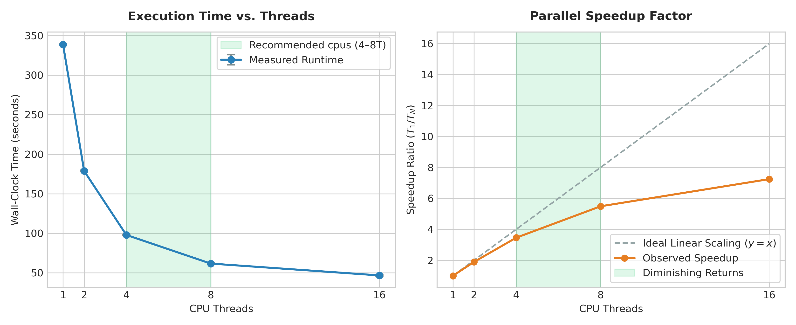

# Input, Usage & Outputs

`sbam` takes as input a consensus genome assembly in `FASTA` format alongside either the raw long reads (`FASTQ` / `FASTA`, uncompressed or `.gz`) used to generate it **or** a pre-aligned coordinate-sorted `BAM` file (`--bam`).

---

## Basic Usage

### Standard Single-Sample Run

```bash
sbam -a assembly.fasta -r reads.fastq.gz -o path/to/output_dir
```

### Production Run with Sample Prefix, Genome Size, Offline SVG Plots, Log File, and Cleanup

```bash
sbam -a assembly.fasta \
     -r reads.fastq.gz \
     -o path/to/output_dir \
     --prefix isolate_01 \
     -t 8 \
     -g 5.3m \
     --read-type lr:hq \
     --offline \
     --clean \
     --log
```

### Re-Run Without Re-Aligning (`--bam`)

Re-evaluate thresholds (`--min-concordance`, `--depth-variance`, `--k-list`, `--min-ori-length`, `--genome-size`) or regenerate offline plots/tracks against an existing BAM without re-running `minimap2`:

```bash
sbam -a assembly.fasta \
     --bam path/to/alignment.sorted.bam \
     -o path/to/output_dir \
     --prefix isolate_01_tuned \
     --min-concordance 0.90 \
     --offline
```

### Linear Replicon Mode (`--linear`)

For organisms with naturally linear chromosomes or linear plasmids/phages (e.g., *Streptomyces*, *Borrelia*), bypass cyclic buffer construction and evaluate linear termini and central-*oriC* symmetry:

```bash
sbam -a linear_assembly.fasta -r reads.fastq.gz -o path/to/output_dir --linear --prefix linear_01
```

### Cohort Summary Mode (`sbam summarize`)

When evaluating multiple isolates across a sequencing run, use `sbam summarize` to compile all generated `*_sbam_metrics.json` files into a cohort summary table (`.tsv` or `.csv`) and a cross-sample recurrent motif table:

```bash
sbam summarize "path/to/results/*/*_sbam_metrics.json" -o cohort_summary.tsv
```

---

## Command-Line Parameters

### Required & Mutually Exclusive Inputs (`sbam` / `sbam run`)

| Flag | Argument | Description |
| :--- | :--- | :--- |
| `-a`, `--assembly` | `FILE` | **[Required]** Path to the polished consensus assembly (`FASTA`). |
| `-r`, `--reads` | `FILE` | Path to the long reads (`FASTQ` / `FASTA`, plain or `.gz`). Mutually exclusive with `--bam` (one of `-r` or `--bam` is required). |
| `--bam` | `FILE` | Path to a pre-aligned coordinate-sorted `BAM` (auto-indexed via `samtools index` if `.bai`/`.csi` is missing; cyclic vs. linear contig naming is auto-detected from BAM headers). Mutually exclusive with `-r/--reads`. |
| `-o`, `--outdir` | `DIR` | **[Required]** Output directory for reports, metrics, diagnostic tracks, and alignments. |

### Optional Arguments (`sbam` / `sbam run`)

| Flag | Default | Description |
| :--- | :--- | :--- |
| `--prefix`, `--sample-name` | Assembly filename | Sample prefix used for output filenames (`<prefix>_sbam_report.html`, `<prefix>_sbam_metrics.json`, diagnostic tracks), HTML title, and `sbam summarize` sample IDs. |
| `-t`, `--threads` | `4` | Number of CPU threads ($\ge 1$) allocated to `minimap2`, `samtools sort`, and flat-chunked `BaseAccuracy` CIGAR sweep workers (`threads=1` runs directly without multiprocessing overhead). |
| `-g`, `--genome_size`, `--genome-size` | `None` | Expected species genome size. Accepts suffixes such as `4.8m`, `4.8mbp`, `4800kb`, or raw integer base pairs `4800000`. |
| `--buffer-size` | `50000` | Length of the cyclic sequence buffer ($\text{bp}$) appended to the $3'$ end of each contig for circular read mapping ($\ge 1000\text{ bp}$). Ignored when `--linear` or `--bam` is used. |
| `--read-type` | `map-ont` | `minimap2` alignment preset. Choices: `map-ont` (standard ONT), `lr:hq` (ONT R10.4.1 / Q20+ SUP), `map-pb` (PacBio CLR), `map-hifi` (PacBio HiFi). |
| `--min-concordance` | `0.85` | Minimum empirical read-to-assembly base concordance ($0.50 < c \le 1.0$) before a position is counted as discordant. Sites with $< 50\%$ read support are tracked separately as majority consensus errors. |
| `--depth-variance` | `2.5` | Fold-change threshold relative to median contig depth ($> 1.0$; $\text{median} \times V$ and $\text{median} / V$) used to mask collapsed repeats or coverage dips. |
| `--k-list` | `4,5,6` | Comma-separated $k$-mer sizes ($2\text{--}10$) to test for systematic motif discordance. |
| `--min-ori-length` | `500000` | Minimum contig length ($\text{bp}$, $> 0$) required to run chromosomal GC-skew replication symmetry and DnaA-box analysis. |
| `--linear` | `False` | Treat replicons as naturally linear rather than circular end-to-end: skips cyclic buffer creation, evaluates $5'/3'$ termini, uses edge-padded linear GC-skew smoothing and central-*oriC* symmetry, and renders linear GC-skew plots. |
| `--offline` | `False` | Omit external Plotly CDN scripts and render all polar or linear GC-skew architecture maps using `sbam`'s built-in zero-dependency inline SVG engine (ideal for air-gapped HPC nodes). Note: even without `--offline`, the HTML report automatically falls back to inline SVG if Plotly fails to load. |
| `--emit-tracks` / `--no-emit-tracks` | `--emit-tracks` | Export machine-readable IGV and polishing diagnostic tracks (`<prefix>_masked_regions.bed`, `<prefix>_consensus_errors.tsv`, `<prefix>_consensus_errors.vcf`). |
| `--clean`, `--remove-intermediates` | `False` | Deletes intermediate alignment files created by `sbam` (`cyclic_assembly.fasta`, `alignment.sorted.bam`, and `alignment.sorted.bam.bai`) after completion. User-supplied `--bam` files are never deleted. |
| `--log`, `--log-file` | `None` | Writes a unified execution log via Python `logging` (capturing `sbam` messages plus isolated `minimap2` and `samtools` stderr). If passed without a path (`--log`), saves to `<outdir>/sbam.log`. |
| `-V`, `--version` | — | Print the installed `sbam` version and exit. |

---

## How to Choose Key Parameters

To get the most accurate and efficient results from `sbam`, it helps to understand how the optional parameters interact with your sequencing data.

### `-g, --genome_size`

`sbam` evaluates the assembly against the expected biological size of the organism. It calculates a total **Size Completeness** score, allowing it to warn you if the assembler dropped massive regions of DNA ($< 90\%$ of expected size), if accessory plasmids, uncollapsed repeats, or contamination inflated the assembly ($> 110\%$), or if the primary chromosome is fragmented ($< 85\%$ of expected genome size despite total length being within $90\%\text{--}110\%$).

It does not require an exact base-pair value, as it tolerates a $\pm 10\%$ size window before triggering a warning. You can provide a known species reference size (e.g., `-g 5.3m` for *Klebsiella pneumoniae*) or estimate it directly from your raw reads using tools like [lrge](https://github.com/mbhall88/lrge).

### `--buffer-size`

Bacterial chromosomes and plasmids are physical circles, but a `FASTA` file represents each sequence as a linear string of bases. The coordinate where a circular sequence is artificially opened is called the "seam" or junction. If a sequencing read spans this artificial breakpoint, a standard aligner mapping against a linearized reference will split the read into supplementary alignments or soft-clip the overhanging bases.

To solve this, `sbam` copies the first $B$ bases of each contig and appends them to the $3'$ end of the sequence, creating a continuous runway across the seam. Reads spanning the boundary align continuously across coordinate $L$ (the original contig length) rather than clipping.

**Rule of thumb:** Ensure `--buffer-size` is larger than your longest sequencing reads. For standard Nanopore libraries with read $N_{50} \approx 10\text{--}25\text{ kb}$, the default `50000` ($50\text{ kb}$) provides ample margin. If you are analyzing ultra-long Nanopore libraries with reads exceeding $100\text{ kb}$, increase the buffer accordingly (e.g., `--buffer-size 150000`).

### `-t, --threads`

`sbam` parallelizes `minimap2` read alignment, `samtools sort`, and flat-chunked `BaseAccuracy` CIGAR sweeps across all contigs. We recommend running `sbam` with **4 to 8 threads**, after which disk I/O and BAM decompression yield diminishing returns.



*Figure 1. CPU thread scalability across alignment and base profiling stages.*

---

## Output Files

Running `sbam` produces the following files inside `--outdir` (where `<prefix>` defaults to the assembly filename unless `--prefix` is specified):

1. **`<prefix>_sbam_report.html`**:
   A self-contained HTML dashboard displaying:
   * **Executive Summary & Inspection Notes**: Overall rate-based assembly verdict (`ACCEPT`, `ACCEPT (WITH NOTES)`, `ACCEPT WITH CAUTION`, `REVIEW`, `FAIL`, or `INSUFFICIENT COVERAGE`), prominent inspection notes for minor findings within acceptance thresholds, and an **Assembly Overview** table covering continuity and base-level consensus QC (`<50% Err | Masked`) across **all** contigs (chromosomes and plasmids).
   * **Confidence Profile Cards**: At-a-glance status for Seam & Contig Continuity, Replication Structure, Primary Base Concordance (empirical read-concordance $\text{QV}$ and consensus errors per $\text{Mb}$), and Size Completeness.
   * **Continuity & Circularity Table**: Per-contig length, average depth, relative copy number (e.g., $1.0\text{c}$, $0.6\text{c}$, $4.4\text{c}$), spanning vs. clipped read counts, and continuity scores.
   * **Replication Structure & Architecture Maps**: Replichore symmetry ($^\circ$), predicted *oriC* and *ter* coordinates, DnaA-box enrichment ($\pm 25\text{ kb}$ observed vs. expected counts, fold enrichment, and Poisson $p$-value), *oriC* rotation status (`ROTATED`, `NEAR_ORIC`, `UNROTATED`, or `LINEAR`), and interactive Plotly (or inline SVG) polar or linear GC-skew maps.
   * **Base-Level Analysis**: Breakdown of structurally masked bases ($\%$), **Majority Consensus Disagreement ($< 50\%$ read support)** vs. **Minority Sub-Consensus Read Disagreement ($50\%\text{--}85\%$ read support)**, read-base **SNP vs. Indel rates** and **Read-Strand Bias** counts, excluded structural regions ($\ge 20\text{ bp}$), and the **Clustered Motif Families** table with mutually exclusive site and consensus-error assignment, SNP/indel split, read-strand concordance, and 3-state reference-orientation classification.

2. **`<prefix>_sbam_metrics.json`** *(Schema Version 2)*:
   A structured machine-readable JSON file containing `schema_version` (`2`), `sbam_version`, `sample_name`, `assembly`, `linear_mode`, `min_ori_length`, `verdict`, `completeness_pct`, `junction_metrics`, `replication_metrics`, `tracks`, and `base_fidelity` (including untruncated `low_concordance_blocks`, `snp_rate`, `indel_rate`, `total_mismatches`, `total_insertions`, `total_deletions`, `consensus_error_snp_sites`, `consensus_error_indel_sites`, `read_strand_biased_sites`, `contig_base_metrics`, and `systematic_motifs`).

3. **Diagnostic Tracks** *(generated by default unless `--no-emit-tracks` is set)*:
   * **`<prefix>_masked_regions.bed`**: BED6 track covering all structurally masked intervals ($\ge 20\text{ bp}$) across all contigs with category, classification reason, mean concordance score, and mean depth.
   * **`<prefix>_consensus_errors.tsv`**: Tab-separated table of every unmasked $< 50\%$ majority disagreement site across all contigs (`contig`, `pos_1based`, `ref_base`, `depth`, `concordance`, `matches`, `mismatches`, `insertions`, `deletions`, `dominant_error_type`, `fwd_depth`, `fwd_concordance`, `rev_depth`, `rev_concordance`, `strand_pvalue`, and 11-bp `context`).
   * **`<prefix>_consensus_errors.vcf`**: Minimal `VCFv4.2` file listing all $< 50\%$ consensus disagreement sites with `DP`, `CONC`, `ETYPE`, and `SPVAL` INFO annotations for direct loading in IGV or downstream workflows.

4. **`cohort_summary.tsv` & `cohort_summary_recurrent_motifs.tsv`** *(generated via `sbam summarize`)*:
   * `cohort_summary.tsv`: Aggregates 27 structural, geometric, and base-level metrics per isolate across a study (using `sample_name` and exact schema v2 `low_concordance_blocks` / `consensus_error_bases`).
   * `cohort_summary_recurrent_motifs.tsv`: Aggregates motif families across all samples in the batch, calculating cohort prevalence ($\%$), total unique discordant sites, total consensus errors, and classifying families as `Recurrent Batch/Basecaller Signature` ($\ge 2$ samples) vs. `Sample-Specific Motif`.

5. **`sbam.log`** *(optional, created when `--log` is passed)*:
   A complete chronological log combining `sbam` progress messages, `minimap2` alignment statistics, and `samtools` output.

6. **Intermediate Files** *(automatically deleted when `--clean` is passed)*:
   * `cyclic_assembly.fasta`: Contigs extended with the cyclic $3'$ buffer (not created in `--linear` or `--bam` mode).
   * `alignment.sorted.bam` & `alignment.sorted.bam.bai`: Sorted and indexed read alignments generated by `sbam` (user-supplied `--bam` files are preserved).
